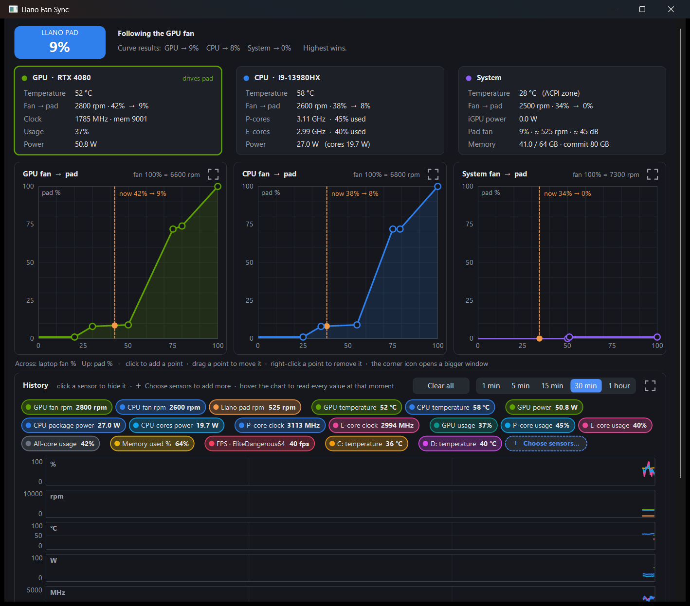
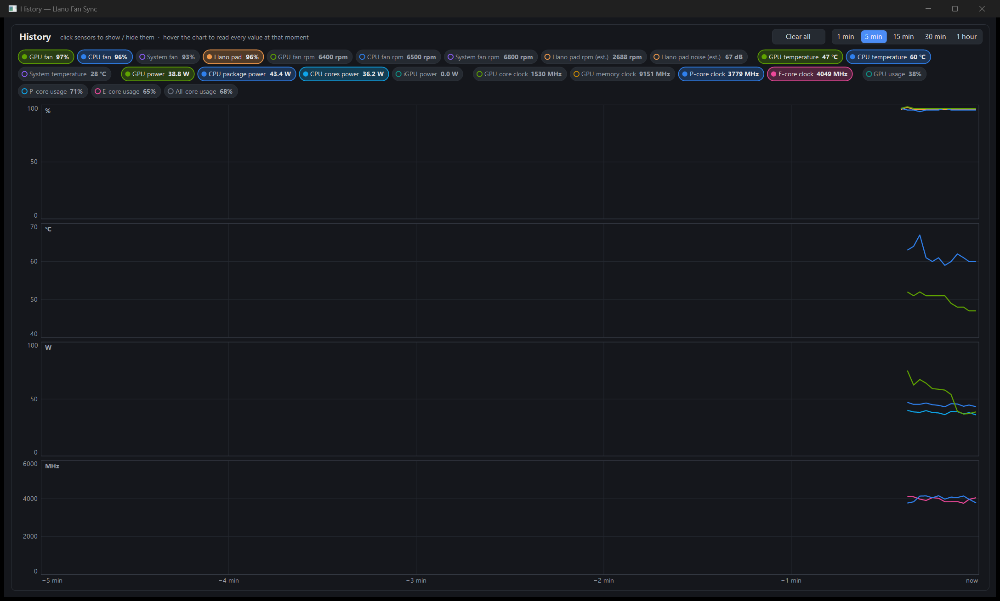
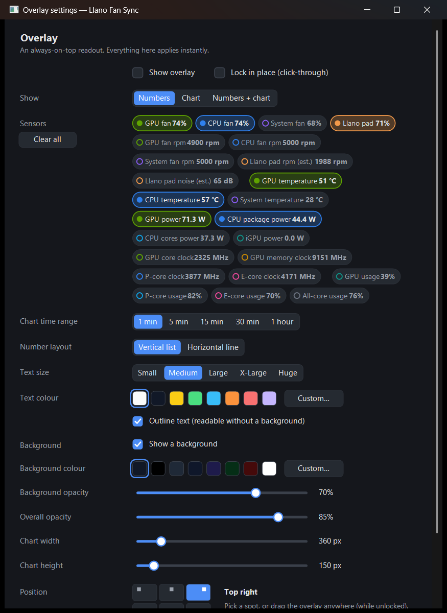

# LlanoFanSync for the ROG Strix SCAR 16 (2023)

A small, native Windows tray app that makes a **llano V12 Ultra** laptop cooling pad follow the fans of an
**ASUS ROG Strix SCAR 16 (2023, G634JZ)**: whichever of the laptop's three fans (CPU, GPU, system) is working
hardest sets the pad's speed, through curves you draw yourself.

The pad's own "AI" mode only looks at CPU temperature, so it lags behind the laptop and ignores the GPU.
This app watches the real fan speeds instead, the same values Armoury Crate shows.



## Features

- **Pad follows the laptop fans.** One curve per laptop fan (GPU, CPU, system): laptop fan % → pad %.
  The highest of the three wins. Click to add a point, drag to move, right-click to remove; changes apply instantly.
- **Respects the pad's wheel.** Turn the speed wheel on the pad and the app leaves the pad alone and shows
  "Manual (wheel)", until you press *Take back control*, un-pause, or restart.
- **Live monitor:** fan rpm and %, CPU / GPU / system temperatures, CPU P-core and E-core clocks and usage,
  GPU clock, usage and power, CPU package / cores / iGPU power, memory used and committed, per-disk temperature,
  active time and read / write MB/s, FPS of the game in front, and the pad's speed, rpm and estimated noise.
- **History chart:** tick any combination of sensors. Each unit (%, rpm, °C, W, MHz, GB, MB/s, fps, dB) gets its own
  band on one shared time axis, so you can line up a power spike with the temperature and fan change it caused.
  Hover to read every value at that moment. 1 minute to 1 hour.
- **Bigger windows:** the corner icon on each curve and on the chart opens it in its own resizable window.
- **Overlay:** always-on-top readout over games. Numbers, a chart, or both; its own sensor list and time range;
  background on/off, colour and opacity; text colour, size and outline; overall opacity; 9 anchor positions or drag it
  anywhere; lock it in place to make it click-through.
- **Light / dark / follow Windows** theme. Every window resizes and scrolls when smaller than its content.
- **Starts with Windows** (optional) straight into the tray.
- **Close to zero cost:** about 0.005 % of the CPU and ~3 MB of RAM in the tray (measured on an i9-13980HX).





## Requirements

- **Laptop:** ASUS ROG Strix SCAR 16 (2023), G634JZ. Other ASUS laptops with the ATKACPI driver will probably read
  their fans the same way, but the fans' 100 % rpm values are set for the G634JZ (see *Adapting to another laptop*).
- **Pad:** llano V12 Ultra (USB HID `374A:B101`, HOLTEK).
- **Windows 10 or 11, x64.** No admin rights needed.
- Quit llano's own **Myth.Cool** app, otherwise both fight over the pad.

## Build

You need **Visual Studio 2019 or newer** (any edition, or the free *Build Tools for Visual Studio*) with the
**Desktop development with C++** workload. Nothing else: no CMake, no packages, one source file.

```bat
git clone https://github.com/sijav/LlanoFanSyncWithStrixScar16_2023.git
cd LlanoFanSyncWithStrixScar16_2023
build.bat
```

The result is `build\LlanoFanSync.exe` (a single self-contained exe, the C runtime is linked in).

Building by hand from a *x64 Native Tools Command Prompt*:

```bat
cl /nologo /std:c++17 /O2 /MT /EHsc /W3 /DUNICODE /D_UNICODE /utf-8 src\LlanoFanSync.cpp /Fe:LlanoFanSync.exe ^
   /link /SUBSYSTEM:WINDOWS /OPT:REF /MANIFEST:EMBED
```

## Install and run

1. Copy `LlanoFanSync.exe` to a folder of your choice, for example `%LOCALAPPDATA%\LlanoFanSync`.
2. Run it. The window opens and a tray icon showing the pad's speed appears.
3. Tick **Start with Windows** to start it at login, minimised to the tray (`/background`).

Closing the window hides it to the tray; use the tray menu's **Exit** to quit. Starting the exe again while it runs
just opens the existing window.

Settings are saved in `LlanoFanSync.ini` next to the exe (created on first run). Everything can be changed in the
window; manual edits to the ini are picked up within a few seconds. A small `LlanoFanSync.log` records starts, the pad
connecting / disconnecting and wheel take-overs.

## How it works

### Laptop fans

The ASUS `ATKACPI` driver (the one Armoury Crate and G-Helper use) answers the ACPI `DSTS` method through
`DeviceIoControl(\\.\ATKACPI, 0x0022240C)`, without admin rights:

| Device id    | Value                                |
|--------------|--------------------------------------|
| `0x00110013` | CPU fan: `(value - 0x10000) * 100` rpm |
| `0x00110014` | GPU fan                              |
| `0x00110031` | system (middle) fan                  |
| `0x00120094` | CPU temperature, low 16 bits = °C    |

Fan % = rpm / the fan's maximum. On the G634JZ: **CPU 6800, GPU 6600, system 7300 rpm** (`kCpuMaxRpm`,
`kGpuMaxRpm`, `kSysMaxRpm` in the source).

### llano V12 Ultra

The pad is a HID device (`VID 374A`, `PID B101`) controlled with one 8-byte feature report (report id 0):

```
[ mode, fan_speed %, on_off, light_on_off<<7 | light_mode, light_color_mode, light_speed, light_power, ~sum(bytes 0..6) ]
```

- Writing `mode = 1` puts the pad under software control at `fan_speed %`. The other bytes are kept as read,
  so on/off and lighting are untouched.
- Reading back, `mode` is `0x80` under software control and `0x88` when the pad's own **speed wheel** is in control;
  `fan_speed` is always the pad's real current speed.
- The pad's rpm, as its own display shows it: 1 % = 300, 4 % = 400, then `300 + 25 × %` (100 % = 2800 rpm).
- Noise (dB) is estimated from rpm using published review measurements (room noise subtracted).

The protocol was worked out from llano's own software (Myth.Cool / `GPP_USB_Center.exe`) and by watching the pad.

### Other sensors

| Sensor                                   | Source                                                   | When it is read |
|------------------------------------------|----------------------------------------------------------|-----------------|
| CPU P/E clocks and usage                 | PDH `Processor Information`, split by CPU-set efficiency class | always |
| CPU package / cores / iGPU power         | PDH `Energy Meter` (Intel RAPL)                          | always |
| System temperature                       | PDH `Thermal Zone Information`                            | always |
| Memory used / committed                  | `GlobalMemoryStatusEx`                                   | always |
| Disk active time, read / write MB/s      | PDH `PhysicalDisk`                                       | always |
| GPU temperature, clocks, usage, power    | NVML (`nvml.dll` from the NVIDIA driver)                 | only while shown* |
| SSD temperature                          | `IOCTL_STORAGE_QUERY_PROPERTY`, `StorageDeviceTemperatureProperty` | only while shown* |
| FPS                                      | real-time ETW session: DXGI / D3D9 *Present* events      | only while shown* |

The "always" group costs well under a millisecond or two per read and has no side effects, so its history is always
complete. The other three do have side effects, so they're read only while a window, chart or overlay shows them
(\*or with **Also record GPU, SSD temps and FPS in the background** turned on):

- polling NVML every couple of seconds can keep the dGPU from going to sleep (battery);
- the SSD temperature is a command to the drive;
- FPS counting runs inside the game.

NVML is never called while the dGPU is asleep (D3), so the app never wakes it.

FPS needs either admin rights or membership of the Windows group **Performance Log Users** (to start an ETW
session). It follows the app in front; if that app isn't drawing frames, the busiest one that is.

## Adapting to another laptop

- Fan maximums: change `kCpuMaxRpm`, `kGpuMaxRpm`, `kSysMaxRpm` near the top of `src/LlanoFanSync.cpp`.
- Fan device ids: the three `g_atk.Rpm(0x0011….)` calls in `Tick()`. A laptop without a third fan reports 0 for it.
- Default curves: `kGpuDefault`, `kCpuDefault`, `kSysDefault`.

## Limitations

- **No memory (DIMM) temperature.** DDR5 modules have a sensor on their SPD hub, but it sits on the SMBus, which
  only a kernel driver can reach; this app has none.
- The pad doesn't report rpm, only its speed %, so rpm and noise are derived from %.
- Not affiliated with, or endorsed by, ASUS or llano. It talks to your hardware the same way their own software does,
  but use it at your own risk.
